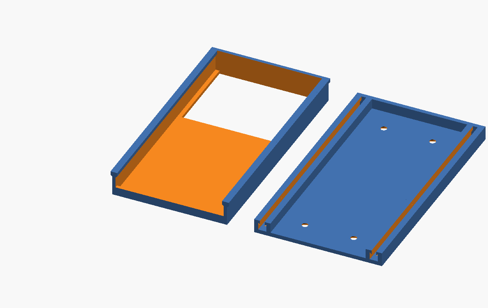
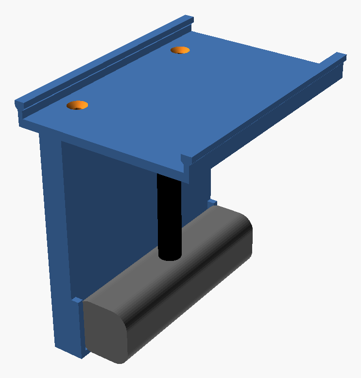

# Phone pocket

A printed pocket for the ceiling, so a phone can be the camera over the
cutting table for [Lantern](../lantern/)'s camera window. The phone drops
in from the open end, screen towards the ceiling, camera end first, and lies
loose on the floor of the pocket with its camera looking down through the
window. Nothing grips it: a lip at the open end stops it sliding out, and it
comes out by pushing it up through the window and drawing it back.



Two parts, four screws:

| Part | What it is | Printed |
|---|---|---|
| `plate.stl` | Screws to the ceiling. A C-channel along each side with an end stop. | Flat, channels up |
| `pocket.stl` | The tray. A bead along the top of each wall slides into the plate's channels. | Floor down, open top up |

Neither needs supports. Use **PETG** if it will sit near the projector's
warm air; PLA sags at about 55 °C. The STLs are for a phone of
**76 × 152 × 10 mm in its case** with 2 mm of clearance all round; for a
different phone, change the three numbers at the top of `phone-pocket.scad`
and export again (OpenSCAD, free):

```sh
openscad -o pocket.stl -D 'part="pocket"' phone-pocket.scad
openscad -o plate.stl  -D 'part="plate"'  phone-pocket.scad
```

`part="fitted"` shows the plate on the pocket and `part="cut"` a slice
through the slide, for checking a change. If the slide is tight on your
printer, raise `slide_gap`.

## Putting it up

1. Screw the plate to the ceiling with the end stop towards the wall and the
   channels running the way you will slide the pocket on. The phone's camera
   needs to see the whole table: for a 53 × 35 in table that is about a
   metre above it with the phone's main lens, half that with the wide one.
   It does not need to be directly above or square to the table; Lantern's
   Find corners takes care of the angle.
2. Slide the pocket onto the plate until it meets the stop. It is held by
   the beads in the channels; nothing else.
3. Drop the phone in, camera end first, screen up. It lies on the floor of
   the pocket with the camera over the window. Lock the phone: Continuity
   Camera starts when the Mac picks it, as long as it is locked, landscape,
   still and nearby.

For the default phone the plate is 94 × 164 mm and the pocket hangs 22 mm
below the ceiling. The window is 60 mm long from the closed end and spans
the floor but for a 3 mm rail each side, which clears any phone's camera
island.

# Webcam hanger

The same plate can hold a webcam instead of the phone. `webcam-hanger.scad`
makes two parts that take the pocket's place: a **slider**, a deck with the
same beaded rail along each side, and a **hanger**, a slab that screws to
the deck's underside and hangs down one side of the camera. The camera bolts
to the hanger by its own tripod thread, lens down, and a ridge along the
hanger's foot and one at each end keep it square so it cannot swing on the
bolt. A slot through the hanger above the camera's back lets the cable
pass through it on its way to the ceiling, rather than round the hanger's
end. It is drawn for a Logitech Brio 4K (a 103 × 28 × 28 mm bar with the
thread in the middle of one long side and the USB-C socket on the back);
for another camera, change the numbers at the top of the file.



| Part | What it is | Printed |
|---|---|---|
| `webcam-slider.stl` | The deck with the rails; slides into the plate's channels like the pocket. | Deck down, rails up |
| `webcam-hanger.stl` | The slab the camera bolts to, with its ridges. | Flat on its outer face, ridges up |

Neither needs supports. Two 4 mm screws go down through the deck's
countersunk holes into the hanger's top edge, and the camera's bolt (a
¼ in thumb bolt) goes through the hanger's hole into the camera's thread.
The hanger is 12 mm thick there, the thread the bolt shows when screwed
fully home, so the head clamps the slab as the bolt bottoms out; set
`cheek_t` to your own bolt's figure, and a washer under the head takes up
a little slack.

```sh
openscad -o webcam-slider.stl -D 'part="slider"' webcam-hanger.scad
openscad -o webcam-hanger.stl -D 'part="hanger"' webcam-hanger.scad
```

`part="fitted"` shows the two parts as hung with the camera in place.

The camera's socket is on its back, so with the lens looking down the plug
points at the ceiling: the hanger drops the camera 82 mm below the deck, 52
for the plug and its strain relief and 30 for the cable to turn and pass
through the slot. With a right-angle plug, set `plug_room` to its height
and the hanger shortens to match. The camera's length runs along the
slide, which is the way its wide picture runs, so put the plate's channels
along the table's long side. From a ceiling 1.3 m above the table the drop
leaves the camera at about 1.22 m, where the Brio's 90° setting takes in
roughly 2.0 × 1.2 m.

## Putting it up

1. Screw the hanger to the slider: slider deck up, hanger's top edge against
   its underside at the countersunk holes, two 4 mm screws from above.
2. Bolt the camera to the hanger, lens down, its thread side against the
   hanger, resting on the foot ridge between the end ridges. Plug the cable
   in before it goes up; it rises from the camera's back, turns, and passes
   through the hanger's slot on its way to the ceiling.
3. Slide the slider into the plate's channels until it meets the end stop,
   the same way as the pocket.
