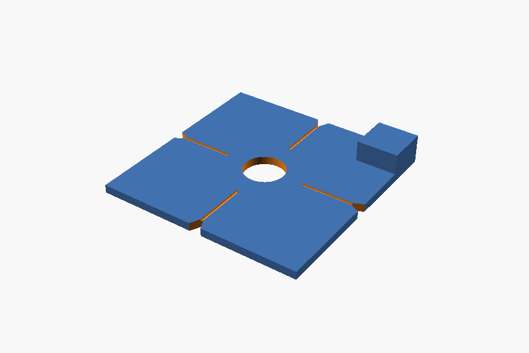

# Dot stencil

A printed stencil for painting the orange dots that [Lantern](../lantern/)'s
Auto looks for, one at each crossing of the mat's lines. Quicker than
sticking a vinyl dot at each crossing, and paint survives being cut over
where vinyl lifts.



| File | What it is | Printed |
|---|---|---|
| `dot-stencil.stl` | A 40 mm square plate, 1.6 mm thick, with an 8 mm hole in the middle, a V-notch in the middle of each edge, a sighting groove from each notch towards the hole, and a lifting tab on one corner | Flat, hole up |

No supports. **PETG** or PLA, 0.2 mm layers, four walls. For a different dot
size or plate, change the numbers at the top of `dot-stencil.scad` and
export again (OpenSCAD, free):

```sh
openscad -o dot-stencil.stl -D 'part="stencil"' dot-stencil.scad
```

## Using it

1. Set the plate on a crossing so that the line runs into the notch on both
   sides, each way; the grooves on top point along the lines. The hole is
   then centred on the crossing.
2. Hold it down with a finger on the tab and colour the hole in with an
   orange paint marker, or dab paint through it with a small sponge. Two
   coats are better than one thick one: a thick dab creeps under the edge.
3. Lift it straight up by the tab and move to the next crossing. Wipe the
   underside now and then so the paint there does not print on the mat.

Any orange will do for Lantern as long as it is plainly orange: acrylic
paint or an acrylic paint marker, two coats, is what the dots so far have
been, and 8 mm (this stencil's size) worked best. Not red, and not yellow.
